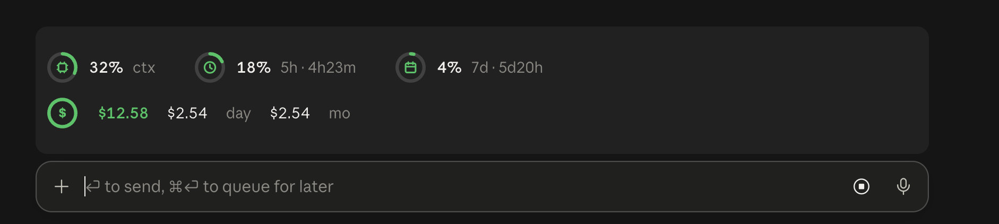

# usage-rings



> Early version: the layout and what the band shows are still evolving.

A Claude Code mod that keeps a usage band above the prompt, drawn as ring gauges:

- **ctx**: how full the context window is
- **5h** and **7d**: plan rate-limit windows, each with the time left until it resets
- any per-model weekly window the API reports, under the model's name
- **spend**: this session's cost, plus totals for today and this month

Ring colors follow the level: green under 60%, amber under 85%, red above. In the terminal the rings become `○ ◔ ◑ ◕ ●` glyphs.

Run `/rings` to hide or show the band.

## Install

At the prompt of a Claude Code terminal session:

```
/plugin install usage-rings --marketplace shiqkuangsan/claude-mod-usage-statusbar
```

From a shell:

```
claude plugin install usage-rings --marketplace shiqkuangsan/claude-mod-usage-statusbar
```

In the Claude desktop app, where `/plugin` does not run: click **+** next to the prompt box, then **Plugins**, **Add marketplace** with `shiqkuangsan/claude-mod-usage-statusbar`, then **Add plugin**.

Requires Claude Code 2.1.287 or later.

## Notes

- Everything shown comes from the usage figures Claude Code reports to the mod. It makes no network calls and reads no files.
- Day and month spend are summed by the mod itself from the time it is installed, across sessions, using Claude Code's plugin storage. Spend from before the install is not counted.
- A fresh session shows the last saved rate-limit reading until its first response arrives; context shows `–` until then.

## License

MIT
